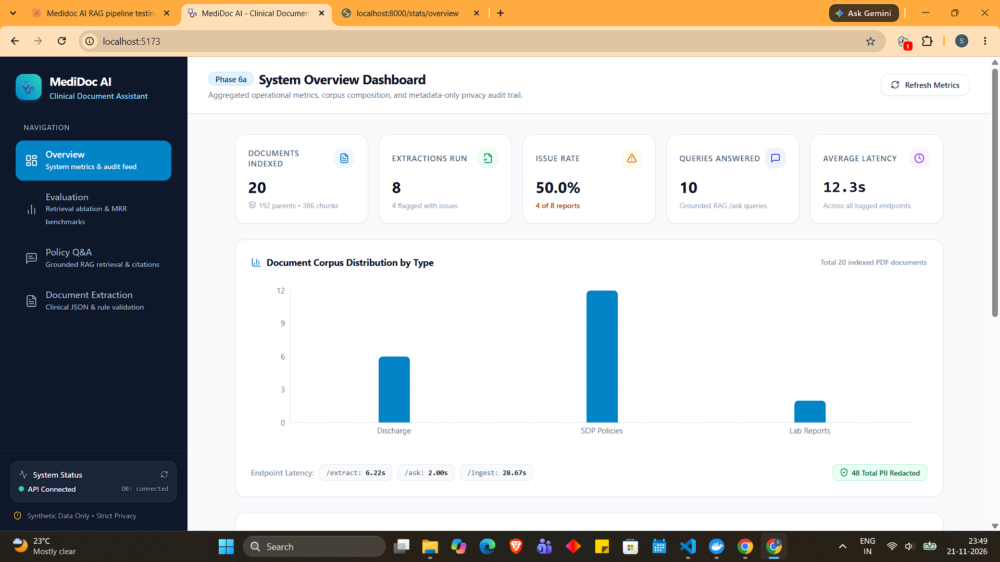
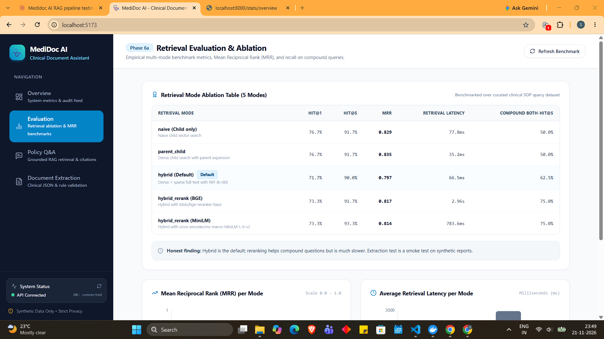
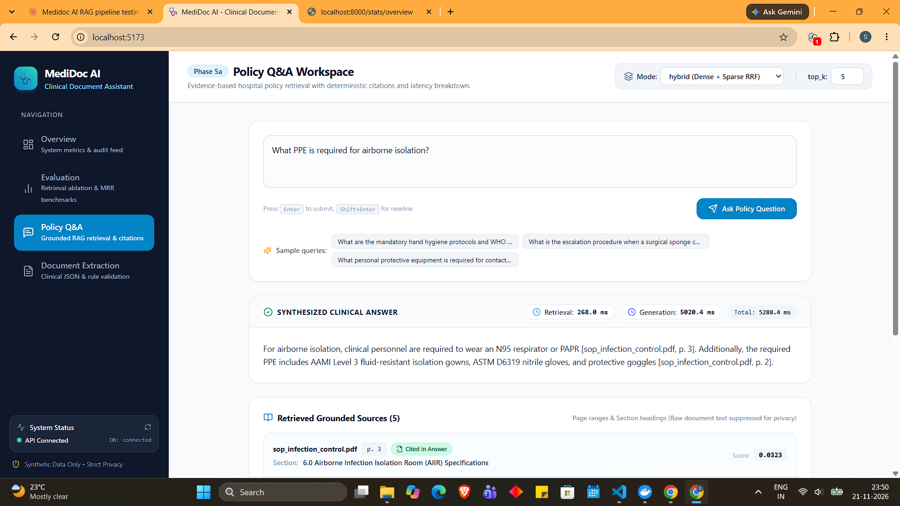
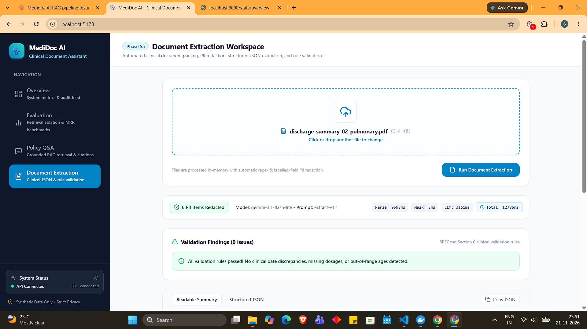

# MediDoc AI — Clinical Document Assistant

MediDoc AI is an evidence-based clinical document and hospital policy assistant designed for healthcare-IT environments (EMR/HMIS). It provides grounded, verifiable question answering across hospital Standard Operating Procedures (SOPs) using hierarchical Retrieval-Augmented Generation (RAG) across four retrieval modes, automated structured JSON extraction from clinical discharge summaries and laboratory reports, deterministic business rule validation, pre-LLM PII redaction, and metadata-only operational audit logging with real-time analytics dashboards.

> **Important Notice:** All hospital documents, clinical reports, patient identifiers, and policies used in this repository are strictly **synthetic** (generated programmatically using ReportLab). No real protected health information (PHI) or real patient records are ever used, stored, or processed.

---

## What MediDoc AI Does

- **Document Ingestion (`POST /ingest`):** Uploads multi-page PDFs, parses section headings and tables using Docling (with automatic pypdf fallback), creates coarse parent sections ($\le$ 1500 tokens), splits them into sentence-aligned child chunks (~100 tokens, 20-token overlap), generates 384-dimensional dense embeddings (`BAAI/bge-small-en-v1.5`), and indexes PostgreSQL full-text search vectors (`tsvector`).
- **Four Retrieval Modes behind one unified API (`POST /ask`):**
  1. *Naive:* Dense cosine similarity search over child chunks, returning child text directly.
  2. *Parent-Child:* Dense cosine search over child chunks, expanded to deduplicated coarse parent sections.
  3. *Hybrid (Default):* Reciprocal Rank Fusion (RRF $k=60$) combining top-50 dense pgvector candidates with top-50 PostgreSQL full-text search candidates (`ts_rank_cd`), expanded to deduplicated parent sections.
  4. *Hybrid Rerank:* Candidate pools re-scored using a cross-attention transformer (`cross-encoder/ms-marco-MiniLM-L-6-v2` or `BAAI/bge-reranker-base`), deduplicated, and expanded to parent sections.
- **Grounded Q&A with Deterministic Provenance Citations:** Synthesizes answers using prompt template `rag-clinical-v1.1`. The LLM cites evidence exclusively via numeric tokens (`[S1]`, `[S1, S4]`). Post-processing deterministically replaces tokens with verified metadata citations (`[document, pages]`), drops and flags invalid or hallucinated citations, and reports stage latencies ($\text{retrieval ms} = \text{total} - \text{generation}$).
- **Structured Extraction & Clinical Rule Validation (`POST /extract`, `POST /validate`):** Redacts PII and extracts structured clinical schemas (`patient`, `diagnosis`, `medications`, `admission_date`, `discharge_date`, `summary`) with single-turn schema self-correction. Validates 4 compliance rules:
  1. `discharge_date_before_admission`: Discharge date must not precede admission date.
  2. `medication_missing_unit`: Every medication must specify dose and unit.
  3. `diagnosis_empty`: Diagnosis list must not be empty.
  4. `age_between_0_and_120`: Patient age must be between 0 and 120.
- **Privacy-First PII Masking:** Regex and labelled-field rules sanitize names (`[NAME]`), phone numbers (`[PHONE]`), emails (`[EMAIL]`), and MRNs/IDs (`[MRN]`) before text reaches the LLM.
- **Metadata-Only Operational Audit Trail:** Records endpoint, document ID, masked item counts, latency, and status in `audit_log`. **Raw document text and clinical narratives are never logged or stored.**
- **Single-Page Application (SPA) Dashboards:** React + Vite + Tailwind + Recharts web app with Overview, Evaluation, Policy Q&A, and Document Extraction workspaces.

---

## Architecture & Tech Stack

```text
  [PDF Documents] (Hospital SOPs, Discharge Summaries, Lab Reports)
         │
         ▼
  ┌─────────────────────────────────────────────────────────────┐
  │                      Ingestion Pipeline                     │
  │  Docling / pypdf ──► Parent Sections (<=1500 tokens)        │
  │                   ──► Child Chunks (100 tok, 20 overlap)    │
  │                   ──► BAAI/bge-small-en-v1.5 Embeddings     │
  └──────────────────────────────┬──────────────────────────────┘
                                 │
                                 ▼
  ┌─────────────────────────────────────────────────────────────┐
  │                 PostgreSQL 16 Storage Layer                 │
  │  pgvector HNSW Cosine Index  │  GIN tsvector Index          │
  │  Documents, Parents, Children, Extractions, Audit Log       │
  └──────────────────────┬──────────────────────────────┬───────┘
                         │                              │
         ┌───────────────┘                              └───────────────┐
         ▼                                                              ▼
┌─────────────────────────────────┐            ┌──────────────────────────────────┐
│      Policy Q&A Pipeline        │            │  Extraction & Privacy Pipeline   │
│  Dense + Sparse (RRF k=60)      │            │  Pre-LLM PII Masker (Regex/Tags) │
│  Cross-Encoder Reranking        │            │  LLM Structured Output           │
│  Parent Section Expansion       │            │  Clinical Business Rule Engine   │
│  Deterministic Citations ([S#]) │            │  Metadata-Only Audit Logging     │
└────────────────┬────────────────┘            └────────────────┬─────────────────┘
                 │                                              │
                 └───────────────────────┬──────────────────────┘
                                         ▼
                             FastAPI REST API (:8000)
                                         │
                                         ▼
                         React + Vite Frontend (:5173 / :80)
```

| Layer | Technology |
|---|---|
| **Language & Runtime** | Python 3.12, Node.js 22 |
| **API Framework** | FastAPI 0.163, Pydantic v2, Uvicorn |
| **Database & Search** | PostgreSQL 16, pgvector 0.5.1, Full-Text Search (GIN `to_tsvector`) |
| **RAG & Embeddings** | LangChain, `langchain-huggingface`, `BAAI/bge-small-en-v1.5` (384-dim) |
| **Reranking** | `cross-encoder/ms-marco-MiniLM-L-6-v2` (default), `BAAI/bge-reranker-base` |
| **LLM Provider** | Google Gemini (`gemini-3.1-flash-lite` / `gemini-2.5-flash`), OpenAI adapter |
| **Document Parsing** | Docling (with cached singleton lifespan), pypdf, ReportLab |
| **Frontend UI** | React 18, Vite, Tailwind CSS, Recharts, Lucide Icons, Nginx |
| **Containerization** | Docker, Docker Compose, Named Volumes (`postgres_data`, `hf_cache`) |

---

## Quickstart with Docker Compose

### 1. Prerequisites
- Docker Engine 24+ and Docker Compose v2+
- Google Gemini API key (set in `.env`)

### 2. Configure Environment
Clone the repository and create your local environment file:
```bash
cp .env.example .env
```
Edit `.env` and set your `GEMINI_API_KEY`:
```ini
GEMINI_API_KEY=your-gemini-api-key-here
LLM_MODEL=gemini-3.1-flash-lite
```

### 3. Build & Start All Services
Launch the database, FastAPI backend, and Nginx frontend:
```bash
docker compose down -v
docker compose up --build -d
```
All containers initialize with automated healthchecks:
- **Frontend Dashboard:** `http://localhost:5173`
- **Backend API Docs (Swagger):** `http://localhost:8000/docs`
- **Health Probe:** `http://localhost:8000/health`

### 4. Ingest SOPs & Seed Demo Data
To populate the database with synthetic hospital policies, extract clinical reports, and execute sample queries inside the running container:
```bash
# Generate synthetic PDFs if not already present
docker compose exec backend python data/generate_synthetic.py

# Ingest all 12 SOPs, run clinical extractions, and submit 10 benchmark queries
docker compose exec backend python scripts/seed_demo_data.py
```

### 5. Run Evaluation Harness inside Container
Run the automated 60-question retrieval ablation benchmark:
```bash
docker compose exec backend python -m backend.app.eval.run --modes naive parent_child hybrid
```

---

## Local Development (Without Docker)

### 1. Database
Run PostgreSQL with pgvector via Docker:
```bash
docker compose up -d postgres
```

### 2. Backend
```bash
python -m venv .venv
source .venv/bin/activate  # Or on Windows: .venv\Scripts\activate
pip install -r backend/requirements.txt
uvicorn backend.app.main:app --host 0.0.0.0 --port 8000 --reload
```

### 3. Frontend
```bash
cd frontend
npm install
npm run dev
```
Access the application at `http://localhost:5173`.

---

## Retrieval Ablation & Empirical Benchmarks

Evaluated over 60 curated clinical questions across 12 hospital SOPs (44 single-topic, 12 paraphrased vocabulary-mismatched, 8 exact-keyword, and 8 compound multi-topic queries):

| Retrieval Mode | Configuration | All Hit@1 | All Hit@5 | All MRR | Latency (ms) | Compound Both-Hit@5 |
|---|---|---|---|---|---|---|
| `naive` | Dense child search (no expansion) | 0.77 | 0.92 | 0.829 | 62.1 ms | 0.50 (50.0%) |
| `parent_child` | Dense child + parent expansion | **0.77** | **0.92** | **0.835** | **38.2 ms** | 0.50 (50.0%) |
| `hybrid` *(Default)* | Dense + sparse FTS (RRF $k=60$) | 0.72 | 0.90 | 0.797 | 59.0 ms | **0.62 (62.5%)** |
| `hybrid_rerank` | Hybrid + BGE Cross-Encoder | 0.73 | 0.92 | 0.817 | 2849.5 ms | **0.75 (75.0%)** |
| `hybrid_rerank_minilm` | Hybrid + MiniLM Cross-Encoder | 0.73 | **0.93** | 0.814 | 718.9 ms | **0.75 (75.0%)** |

### Benchmark Findings
- **Why `hybrid` is the Default:** Blending dense embeddings with sparse full-text search boosts compound multi-topic recall (`both-hit@5`) from 50.0% to 62.5% and maintains 100% keyword Hit@5 at sub-60ms latency without heavy transformer cross-encoders.
- **Cross-Encoder Value & Cost:** Cross-encoders filter lexical noise on paraphrased queries and push compound recall to 75.0%, but impose a significant CPU latency penalty (~719ms for MiniLM, ~2850ms for BGE).
- **Refusal Guardrails:** Tested across 8 out-of-domain clinical questions (e.g., NICU service animal rules, MRI cooling flow rates); the `/ask` pipeline achieved **100% correct refusals (8/8)** with 0 hallucinations.

---

## Honest Limitations & Trade-Offs

1. **Synthetic Data Boundary:** All SOP policies, clinical discharge summaries, lab reports, patient demographics, and MRNs are generated programmatically. The system has not been tested on real-world electronic health record (EHR) databases.
2. **Template-Based Extraction Smoke Test:** The clinical extraction benchmark scores accuracy against 8 synthetic report templates. It verifies schema parsing, PII redaction, and rule validation integrity, but does not substitute for a clinical NLP trial on heterogeneous physician dictation.
3. **PII Masking Boundary:** Labelled demographic headers (`Patient:`, `MRN:`, `Phone:`, `Email:`) and regex patterns reliably capture standardized hospital identifier formats. However, unlabelled proper names embedded within unstructured narrative prose can occasionally escape regex matching without heavy clinical NER models that risk false positives on clinical terminology.
4. **Hardware Latency Differences:** CPU execution of cross-encoder reranking requires ~0.7s to ~2.8s per query; GPU acceleration is recommended if deploying reranked modes in production.

---

## Application Screenshots

| System Overview Dashboard | Retrieval Evaluation & Ablation |
|---|---|
|  *KPI cards, corpus distribution by doc_type, and privacy audit log feed.* |  *Ablation table, MRR bar chart, latency comparison, and answer synthesis metrics.* |

| Grounded Policy Q&A | Clinical Document Extraction |
|---|---|
|  *Grounded policy chat with mode selector, latency breakdown, and cited sources.* |  *PDF upload, readable patient summary, JSON viewer, and validation severity table.* |

---

## API Endpoints Reference

| Method | Endpoint | Description |
|---|---|---|
| `GET` | `/health` | Health probe reporting database and service status |
| `POST` | `/ingest` | Multi-part PDF upload, chunking, and dual-indexing |
| `GET` | `/documents` | List indexed documents with parent and child chunk counts |
| `POST` | `/ask` | Grounded clinical Q&A across SOPs with source citations |
| `POST` | `/extract` | Extract clinical schema and validation findings from PDF |
| `POST` | `/validate` | Validate raw clinical JSON against business rules |
| `GET` | `/stats/overview` | Aggregated corpus counts, extraction issue rate, and average latency |
| `GET` | `/stats/audit` | Recent metadata-only privacy audit log records |
| `POST` | `/eval/run` | Execute retrieval evaluation benchmark across modes |
| `GET` | `/eval/results` | Retrieve latest ablation table and performance metrics |
